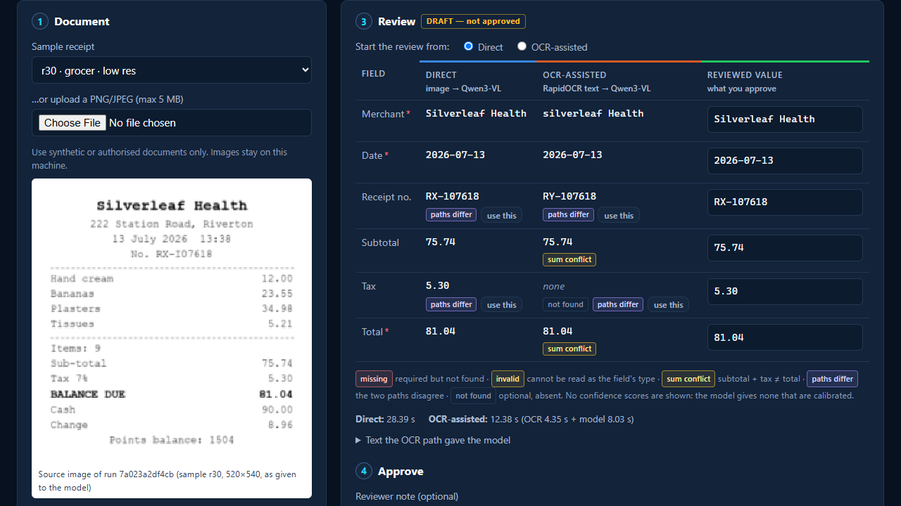
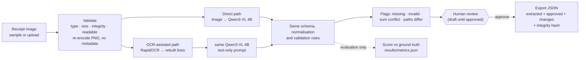
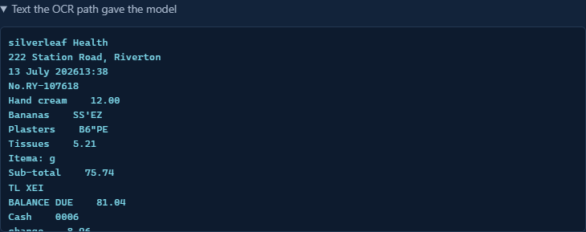
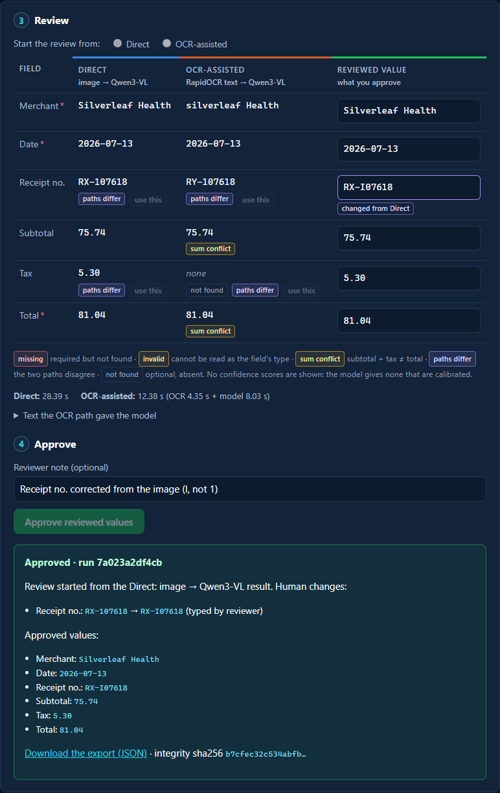
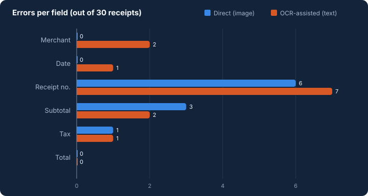

# Visual Document Intelligence

**Image or OCR text? Two local ways to read a receipt, measured side by side. A person makes the final call.**
A local proof of concept. The same local model extracts six fields from a receipt either **directly from the
image** or **from OCR text**. Both paths are scored with the same rules on 30 synthetic receipts, and every result
stays a draft until a reviewer corrects and approves it.

## Explore the project

**[Project site](site/index.html)** (static page; open it from a local clone) ·
**[Demo video](site/media/demo.mp4)** (2:50, English narration and captions) ·
**[Results](docs/metrics-and-results.md)** · **[Demo guide](docs/demo-guide.md)**

[](docs/img/02-both-paths.png)

*A live run on synthetic receipt r30. Direct (blue) and OCR-assisted (orange) drafts sit side by side. The receipt
number differs between the paths, and the OCR path lost the tax line, so its subtotal and total carry a
**sum conflict** flag.*

## What

A small app and an experiment around one question: given a receipt image, should a model read the **image**, or
**text from an OCR engine**?

- **Direct path:** the validated image goes to **Qwen3-VL 4B Instruct** (local, via Ollama), which returns
  merchant, date, receipt number, subtotal, tax and total as schema-constrained JSON.
- **OCR-assisted path:** **RapidOCR** reads the same image, its boxes are rebuilt into printed lines, and only that
  text goes to **the same model**, with the same instructions and schema.
- **Review:** the app shows both drafts next to the image and flags what it can justify: missing required
  fields, invalid values, `subtotal + tax ≠ total`, and fields where the paths disagree. A reviewer corrects,
  approves and exports a JSON record that keeps what each path extracted next to the approved values.

## Why

Document AI has moved from OCR-then-parse pipelines toward models that read the page image directly. Donut (2021)
argued that the OCR stage adds cost and **propagates its errors**. A 2026 benchmark, *OCR or Not?*, found that
image-only input can match OCR-enhanced input for powerful multimodal models. This project asks the same question
at laptop scale, with one small open model, and looks at **how** each path fails, not only how often.

The failures matter more than the averages. On r30 above, OCR turned the line `Tax 7%  5.30` into `TL XEI`, so the
model had no tax to extract. The direct path read the tax correctly but read the ID `RX-I07618` as `RX-107618`.
Neither path got the ID right, and on four other receipts **both paths made the same ID mistake**, so no flag could
fire. That is why a person approves the result.

## How



Everything runs locally: the model on the laptop's integrated GPU through Ollama's Vulkan backend (or on the CPU,
more slowly) and OCR on the CPU. No API keys, no uploads to any service. There are no confidence scores, because
the model gives none that are calibrated. Details: [architecture](docs/architecture.md).

## Quick start

Tested on Windows 11 with Python 3.12 and Ollama 0.34. Needs about 4 GB of disk for the model and 8 GB or more of RAM.

```powershell
git clone https://github.com/Oren1984/visual-document-intelligence.git
cd visual-document-intelligence
py -3.12 -m venv .venv
.\.venv\Scripts\Activate.ps1
pip install -r requirements-dev.txt
ollama pull qwen3-vl:4b-instruct        # 3.3 GB, Apache-2.0 (install Ollama from ollama.com first)
python -m vdi setup                      # English OCR recogniser (9 MB, checksum-verified) + readiness check
```

**Run the app**, then open <http://127.0.0.1:8000>:

```powershell
python -m vdi serve
```

With the normal Ollama server, the model runs on the CPU: about 100 s per image on the test laptop. On a machine
with an Intel/AMD integrated GPU, start a separate GPU-backed Ollama server first. It leaves your normal installation
unchanged.

```powershell
.\scripts\start_ollama_gpu.ps1                        # terminal 1: Ollama on 127.0.0.1:11435 (Vulkan, iGPU)
$env:VDI_OLLAMA_URL = "http://127.0.0.1:11435"        # terminal 2, then: python -m vdi serve
```

**Other commands**

```powershell
python -m vdi extract samples\images\r30.png --method both   # one receipt from the command line (JSON out)
python -m vdi evaluate                                       # both paths on all 30 samples (~17 min on the iGPU)
python -m vdi score                                          # re-score saved predictions, no model needed
python tools\render_results.py                               # results/summary.md + chart from metrics.json
python -m vdi runs                                           # recent run outcomes (no field values)
python -m pytest -m "not e2e"                                # fast tests, no model needed
python -m pytest                                             # all tests, incl. real-model end-to-end checks
```

## Demo flow

1. Pick sample **r30 · grocer · low res** (or upload a PNG/JPEG) and run **Both**.
2. Compare the two drafts: **paths differ** on the receipt number and tax, and a **sum conflict** on the OCR path.
3. Open *Text the OCR path gave the model* to see the garbled tax line.
4. Check the image, type the correct receipt number `RX-I07618`, add a note, and **approve**.
5. Download the export: both drafts, the approved values, the human change and an integrity hash.

| | |
|---|---|
| [](docs/img/03-ocr-text.png) | [](docs/img/05-approved.png) |
| *What the OCR path gave the model: the tax line came out as `TL XEI`.* | *After review: the one human change, where it came from, and the export with its hash.* |

Invalid input is refused before any model runs, for example a text file renamed to `.png`
([screenshot](docs/img/06-rejected-upload.png)). Walkthrough: [demo guide](docs/demo-guide.md).

## Results

30 synthetic receipts (5 layouts × 6 image conditions) × 6 fields = **180 field slots per path**. Protocol fixed
before the first run: [experiment design](docs/experiment-design.md).

| Path | Field accuracy | Receipts fully correct | Key-value F1 | Median time / receipt |
|---|---:|---:|---:|---:|
| **Direct**: image → Qwen3-VL | **170/180 (94.4%)** | 21/30 | 0.947 | 19.6 s |
| **OCR-assisted**: RapidOCR text → Qwen3-VL | **167/180 (92.8%)** | 20/30 | 0.933 | 11.4 s (OCR 4.2 + model 7.6) |



- **Too close to call.** A 3-slot difference on 30 synthetic receipts is noise, not evidence.
- **Receipt numbers dominate both paths' errors**, mostly look-alike swaps (O/0, I/1, S/5).
- **OCR errors propagate**: a lost tax line, a garbled date read as `2023-08-17`, and dropped spaces in merchant names.
- **The image path misreads digits** (`67.58` → `667.58`). The sum rule flagged both such cases.
- **Review flags** pointed to 4 of 10 direct errors and 7 of 13 OCR-assisted errors. **6 errors per path raised no
  flag**, all of them mistakes both paths shared.
- The OCR-assisted path was ~40% faster on this laptop. Two full runs gave **identical values for all 360
  predictions**.

Full tables and every error: [metrics and results](docs/metrics-and-results.md) · [`results/summary.md`](results/summary.md).

## Research sources

- **Primary research basis.** Jiyuan Shen, Peiyue Yuan, Atin Ghosh, Yifan Mai, Daniel Dahlmeier. *OCR or Not?
  Rethinking Document Information Extraction in the MLLMs Era with Real-World Large-Scale Datasets.* 2026.
  [arXiv:2603.02789](https://arxiv.org/abs/2603.02789). The paper benchmarks MLLMs on internal real-world business
  documents with OCR text only, images only, and both. It concludes that for powerful models, image-only input can
  match OCR-enhanced input, and that schema and instruction design matter. **We use its research question.** Our
  two paths correspond to its image-only and OCR-only settings. Its image + OCR setting, datasets, models, error
  framework and results are **not** reproduced.
- **Historical background.** Geewook Kim et al. *OCR-free Document Understanding Transformer* (Donut). First posted
  2021, ECCV 2022. [arXiv:2111.15664](https://arxiv.org/abs/2111.15664). It argued for reading document images end to
  end, because separate OCR adds cost and inflexibility and propagates its errors into later steps. It motivates the
  direct path; we did not implement or run Donut.

What maps to what: [paper mapping](docs/paper-mapping.md).

## Limitations

- **Small and synthetic:** 30 generated English receipts with simulated degradation. Real receipts are harder.
- **One small model, one prompt, one OCR engine,** and six flat fields with no line items. The paper's image + OCR
  setting was not tested.
- **Timing is one laptop** (Intel Core Ultra 7 258V, Arc 140V iGPU). On the CPU alone, an image call takes ~100 s.
- **A local single-user tool:** no accounts, HTTPS or multi-user review; approval records a note, not an identity.
- The demo video's extraction is live, but the reviewer's clicks and typing are scripted.

More: [assurance and limitations](docs/assurance-and-limitations.md).

## Code, experiment and site

- **Code**: `vdi/`, the app, the two paths, validation, review and export, with 87 tests (`tests/`). Four of them
  run the real model on sample receipts.
- **Experiment**: `samples/` (generated receipts and ground truth), `vdi/evaluation.py`, `results/` (every model
  output, OCR text and metric).
- **Site**: `site/`, a static summary page with its own copies of media. It works when only `site/` is hosted
  ([viewing instructions](site/README.md)). It is generated by `tools/build_site.py` and checked by
  `tools/check_site.py`.

## Repository map

| Path | Contents |
|---|---|
| `vdi/` | Package: `images` (input validation), `ocr`, `llm` (local Ollama client), `extract` (the two paths), `schema`, `service` (drafts, approval, export), `runlog`, `app` (FastAPI + one page), `scoring`, `evaluation`, CLI |
| `samples/` | 30 synthetic receipt images + `ground_truth.json` |
| `results/` | `predictions.json` (reported run), `predictions-run1.json` (determinism check), `metrics.json`, `summary.md` |
| `tests/` | Unit, HTTP and real-model end-to-end tests |
| `tools/` | Sample generator, results renderer, site builder and checker, screenshot and video capture |
| `docs/` | [architecture](docs/architecture.md) · [paper mapping](docs/paper-mapping.md) · [experiment design](docs/experiment-design.md) · [sample provenance](docs/sample-provenance.md) · [metrics and results](docs/metrics-and-results.md) · [assurance and limitations](docs/assurance-and-limitations.md) · [demo guide](docs/demo-guide.md) · [media licenses](docs/media-licenses.md) |
| `site/` | Static project site (self-contained) |
| `scripts/` | `start_ollama_gpu.ps1`: optional separate GPU-backed Ollama server |

Git ignores local data (`var/`: uploads, drafts, exports, run log), model files and media sources (`.cache/`).

## Credits

- **Model:** Qwen3-VL 4B Instruct (Qwen team, Apache-2.0), served by Ollama. **OCR:** RapidOCR with PaddleOCR
  PP-OCR models (Apache-2.0).
- **Receipts:** synthetic, generated for this project ([provenance](docs/sample-provenance.md)).
- **Narration:** synthetic voice, Kokoro-82M (Apache-2.0) via kokoro-onnx (MIT).
- **Music in the demo video:** "Airport Lounge" Kevin MacLeod (incompetech.com)
  Licensed under Creative Commons: By Attribution 4.0, https://creativecommons.org/licenses/by/4.0/
  (excerpt, trimmed, volume lowered and ducked under the narration, fades added). [Media licenses](docs/media-licenses.md).

## Contact

Oren Salami · [Main Portfolio](https://nfc4u.co.il/Salami/Ai-Systems-Portfolio/) · [GitHub](https://github.com/Oren1984) ·
[LinkedIn](https://www.linkedin.com/in/oren-salami-b2988a224/)
