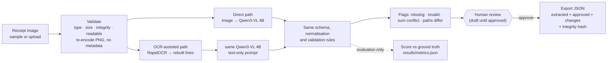

# Architecture and flow

One Python package (`vdi/`), one local web page, one local model server. No database, queue, account system or
cloud service.

## Components

| Module | Responsibility |
|---|---|
| `vdi/images.py` | Accepts PNG/JPEG only (magic bytes and extension must agree). Enforces ≤ 5 MB and ≤ 25 MP, decodes fully to catch truncation, rejects images under 200 px or blank ones, downscales to ≤ 1600 px on the long side, and re-encodes to PNG without metadata. Both paths receive these exact pixels. |
| `vdi/ocr.py` | RapidOCR (PP-OCRv4 detector, English PP-OCRv3 recogniser, ONNX Runtime on CPU). Rebuilds printed lines from box geometry after correcting the dominant skew, and keeps wide gaps as runs of spaces. |
| `vdi/llm.py` | Minimal Ollama client. One instruction text and one JSON schema (structured output) for both paths; temperature 0 and a fixed seed. Refuses any non-local endpoint. Unusable output raises an error; it is never patched up or invented. |
| `vdi/extract.py` | `run_direct`, `run_ocr`. Each returns a `PathResult` labelled with its method, timings per stage, the raw model fields and the validation checks. |
| `vdi/schema.py` | The six fields, their descriptions, normalisation (money, dates, IDs, names) and validation rules. |
| `vdi/service.py` | Runs, drafts (`var/runs/`), approval and export (`var/exports/`). |
| `vdi/runlog.py` | Append-only JSON-lines log of outcomes (`var/runs.jsonl`). It holds no field values, OCR text or upload names. |
| `vdi/app.py` + `templates/`, `static/` | FastAPI on 127.0.0.1, one page of vanilla JS. Strict CSP; no external requests. |
| `vdi/scoring.py`, `vdi/evaluation.py` | Scoring rules and the evaluation harness (run, save predictions, re-score). |

## Review signals (what the reviewer sees)

The app shows only signals it can justify:

- **missing**: a required field (merchant, date, total) is absent.
- **invalid**: a value cannot be interpreted as its type, for example an ambiguous `04/03/2026`.
- **sum conflict**: subtotal + tax ≠ total (or subtotal ≠ total when there is no tax line).
- **paths differ**: when both paths ran, they returned different values for this field.
- **not found**: an optional field is absent, which may be correct.

There are **no confidence scores**. The model's token probabilities are not calibrated field confidences, and
the OCR engine's per-box scores do not map onto fields, so showing either as "confidence" would be invented
precision. How often these signals actually caught errors is measured in
[metrics-and-results.md](metrics-and-results.md#would-a-reviewer-be-pointed-to-the-errors).

## Draft → approved

1. An extraction creates a **draft** run (`var/runs/<id>.json`) holding each path's raw and normalised values and flags.
2. The reviewer starts from one path's values, can take individual values from the other path, or types
   corrections. Edited fields are highlighted.
3. **Approval** re-validates the reviewed values. Invalid or missing required values block it. A remaining sum
   conflict needs an explicit confirmation. An approval is final: a second approval of the same run is refused.
4. The **export** (`var/exports/<id>.json`) contains:
   - the source hash and size;
   - the method, model digest and OCR engine;
   - what each path extracted, with flags and timings;
   - the approved values;
   - per-field provenance (`direct`, `ocr` or `human`);
   - the list of human changes;
   - the reviewer note;
   - a sha256 over the whole record.

## Runtime

- **Model server.** The standard Ollama server (`127.0.0.1:11434`, CPU on this laptop) works as is.
  `scripts/start_ollama_gpu.ps1` starts a *separate* Ollama server on `127.0.0.1:11435` that uses the integrated
  Intel Arc GPU through Ollama's Vulkan backend. It leaves the normal installation unchanged, and cold image calls
  drop from ~100 s to ~19 s. Select it with `VDI_OLLAMA_URL`.
- **OCR.** Runs on the CPU with 4 threads (`VDI_OCR_THREADS`), the fastest setting on this 4-P-core CPU.
- **Local data.** All run data lives under `var/` (or `VDI_DATA_DIR`), which Git ignores.
