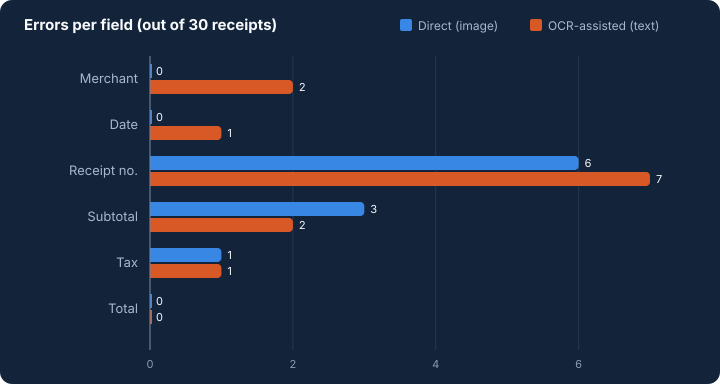

# Metrics and results

Measured on 2026-09-28 (run 3, the reported run; see [experiment-design.md](experiment-design.md)). The complete
generated tables, including every error, are in [`results/summary.md`](../results/summary.md). The raw data is in
`results/predictions.json` (every model output and OCR text) and `results/metrics.json`.

**Setup:** 30 synthetic receipts × 6 fields = **180 field slots per path**. Both paths use the same model
(Qwen3-VL 4B Instruct Q4_K_M via Ollama 0.34.4, on the laptop's Intel Arc 140V iGPU through the Vulkan backend),
prompt, JSON schema, decoding (temperature 0, seed 7) and scoring. OCR is RapidOCR (PP-OCRv4 detection,
English PP-OCRv3 recognition) on 4 CPU threads.

## Headline

| Path | Field accuracy | Exact-match documents | Key-value P / R / F1 | Failed runs | Median s / receipt | Mean s / receipt |
|---|---:|---:|---:|---:|---:|---:|
| **Direct**: image → Qwen3-VL | **170/180 = 94.4%** | 21/30 | 0.942 / 0.953 / 0.947 | 0 | 19.6 | 20.0 |
| **OCR-assisted**: RapidOCR text → Qwen3-VL | **167/180 = 92.8%** | 20/30 | 0.930 / 0.935 / 0.933 | 0 | 11.4 | 11.8 (OCR 4.2 + model 7.6) |

**Reading it honestly:** the direct path made 10 errors and the OCR-assisted path 13. With n = 30 synthetic receipts,
a 3-slot difference is **not** evidence that one path is better. What the data does show is that the two paths
fail **differently**, and that the OCR-assisted path was ~40% faster on this machine. Its model call reads a few hundred text
tokens, while the image call prefills ~1,250 tokens (measured on dev receipts).

Runs 1 and 3 produced identical values for all 360 predicted fields, so these outcomes are reproducible on this
setup. Timings are from run 3 only.

## Per field (correct / incorrect / missing / spurious, out of 30)

| Field | Direct | OCR-assisted |
|---|---|---|
| Merchant | 30 / 0 / 0 / 0 | 28 / 2 / 0 / 0 |
| Date | 30 / 0 / 0 / 0 | 29 / 1 / 0 / 0 |
| Receipt no. | 24 / 6 / 0 / 0 | 23 / 7 / 0 / 0 |
| Subtotal | 27 / 1 / 0 / 2 | 28 / 0 / 0 / 2 |
| Tax | 29 / 1 / 0 / 0 | 29 / 0 / 1 / 0 |
| Total | 30 / 0 / 0 / 0 | 30 / 0 / 0 / 0 |

## Per image condition (correct slots out of 30)

| Condition | Direct | OCR-assisted |
|---|---:|---:|
| clean | 30 | 30 |
| rotated 2.5–4.5° | 29 | 28 |
| blurred | 30 | 30 |
| noise + heavy JPEG | 27 | 26 |
| faded thermal | 30 | 30 |
| low resolution | **24** | **23** |

Clean, blurred and faded receipts were fully correct on both paths. Low resolution caused most errors.

## What went wrong (qualitative)

**1. Confusable characters in IDs are the main failure, and both paths share it.** Receipt numbers account for 6 of
10 direct errors and 7 of 13 OCR-assisted errors. Most are O↔0, I↔1 and S↔5 swaps (`RX-O4957` → `RX-04957`,
`HP-01738O` → `HP-017380`, `INV-1II717` → `INV-111717`). On four receipts both paths produced **the same** wrong
ID, so neither a rule nor cross-path disagreement flagged it. This is the category human review must check by eye, and the
app cannot point to it.

**2. OCR errors propagate; the model cannot recover what OCR lost.** This is Donut's argument, visible in miniature:

- r30: the OCR engine turned `Tax 7%  5.30` into `TL XEI`, so the model had no tax amount. It correctly returned
  `null` rather than inventing one. The direct path read 5.30.
- r06: the date line came back as `0at61 17/83/2826`, and the model turned it into `2023-08-17`. The direct path read
  `2026-03-17`.
- r24 and r10: the recogniser dropped spaces (`KEYSTONEBUILDERS DEPOT`, `Wren &Willow`), which the merchant
  rule counts as wrong.
- r18: OCR glued the label onto the ID (`TransT0051056`).

**3. The direct path misreads digits where OCR does not.** In r18 it read a subtotal of `67.58` as `667.58`, and in
r06 a tax of `7.88` as `7.68`. The OCR path got both right.

**4. The model sometimes computes instead of reading, on both paths.** On r10 and r16, which print only a total, both
paths copied the total into `subtotal` although the instruction says to use null when a field is not printed. On
r18 the OCR text lost the total's value ("AMOUNT DUE" with no number), yet the OCR path returned the correct total
70.96: it evidently added subtotal and tax. That is scored correct, but it was calculated, not read.

**5. No failures of the pipeline itself.** No invalid JSON, timeout or crash occurred in 60 path runs, and the total
was right in all 60.

## Would a reviewer be pointed to the errors?

The app shows two kinds of evidence-based flags: validation rules (missing required field, invalid value,
`subtotal + tax ≠ total`) and **paths differ** when both paths ran.

| Path | Errors | Flagged by a rule | Flagged only because the paths differ | Not flagged | Flags on correct fields |
|---|---:|---:|---:|---:|---:|
| Direct | 10 | 2 | 2 | **6** | 10 |
| OCR-assisted | 13 | 0 | 7 | **6** | 5 |

- The **sum rule** caught both of the direct path's amount misreads (r18, r06). In r30 it flagged the OCR path's
  subtotal and total rows, because the tax had vanished and the amounts no longer added up. That tells the reviewer
  where to look, although the empty tax field itself is optional and carries no rule flag of its own.
- **Running both paths** turned 9 more errors into visible disagreements.
- **Still, 6 errors per path passed unflagged.** They are all identical mistakes made by both paths (confusable
  IDs, and copying the total into a missing subtotal). Flags are not a substitute for reading the receipt.
- "Flags on correct fields" counts the cost: a correct value is flagged when the *other* path got that field wrong, or
  when a sibling amount breaks the sum rule.

**Did human review correct them?** In the recorded demo (r30), the reviewer started from the direct values,
compared the flagged receipt number with the image, and typed the correct `RX-I07618`, a value **neither** path
produced. The export records it as a human change. That is one demonstration, not a user study. The table above
estimates what review would be pointed to across all 30 receipts.

## Timing

| | Direct | OCR-assisted |
|---|---:|---:|
| Median s / receipt | 19.6 | 11.4 |
| Mean (min–max) | 20.0 (16.2–30.1) | 11.8 (8.8–19.9) |
| Stages (mean) | model 20.0 | OCR 4.2 + model 7.6 |

Wall clock for the whole evaluation: 1,003 s. With the model on the CPU instead of the iGPU, a cold image call took
~100 s (measured on dev receipts), so the direct path is the one that needs the accelerator.
